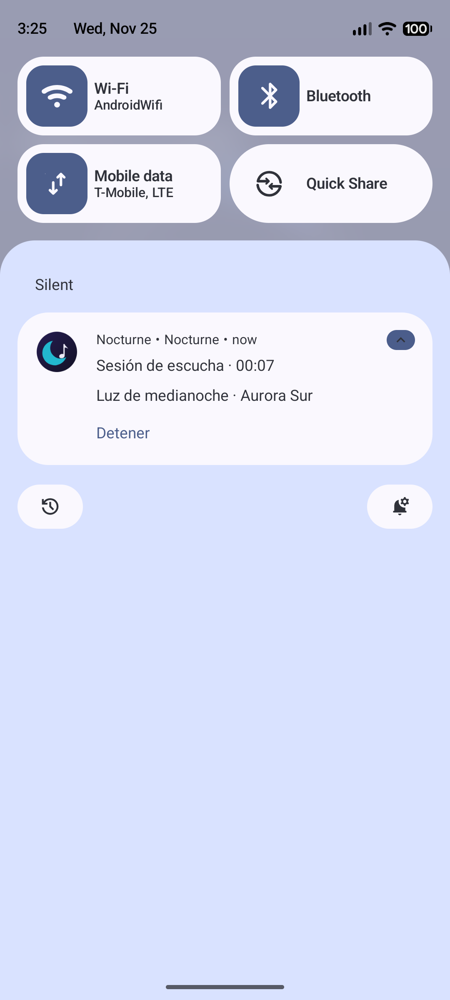
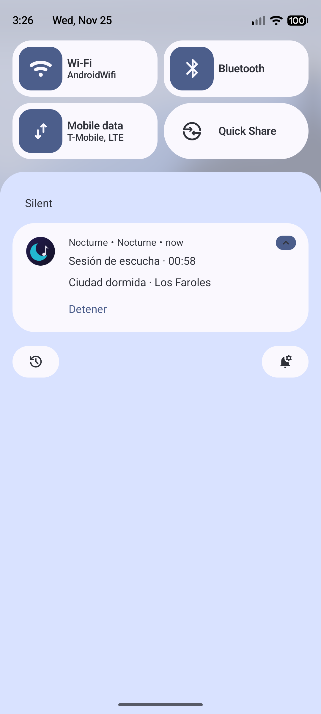
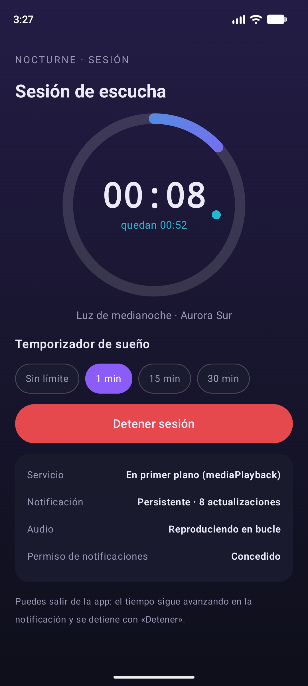

# Lab 11 · Servicio en primer plano y notificación persistente con temporizador

Práctica 11 de *Introducción al Desarrollo de Nuevas Plataformas* (UNSA · 2026-B).
Añade al reproductor **Nocturne** la **sesión de escucha**: un servicio en primer plano
(`mediaPlayback`) que reproduce audio y muestra el tiempo transcurrido en una notificación
persistente, con temporizador de sueño.

Integrantes: Maldonado Vilca Victor Gonzalo · Mamani Anahua Victor Narciso · Quispe Marca Edysson Darwin

  

## Qué hace

- `SesionEscuchaService`: servicio iniciado, `foregroundServiceType="mediaPlayback"`.
  Llama a `startForeground`, reproduce `res/raw/ambiente_nocturne.wav` en bucle y actualiza
  la notificación cada segundo (reloj monotónico, sin deriva). Se detiene con
  `stopForeground(STOP_FOREGROUND_REMOVE)` + `stopSelf()`.
- `NotificacionSesion`: canal `sesion_escucha` (`IMPORTANCE_LOW`) y notificación `ongoing`
  con título «Sesión de escucha · mm:ss», pista actual y acción **Detener**.
- `PantallaSesion` (Compose): pide `POST_NOTIFICATIONS` (Android 13+), inicia y detiene la
  sesión y permite elegir el temporizador de sueño (1, 15 o 30 min).
- `EstadoSesion`: `StateFlow` compartido entre el servicio y la interfaz.

## Evidencias (`docs/`)

- Capturas de inicio, permiso, segundo plano, detención, temporizador e ícono.
- `logcat_ejecucion.txt`: 121 actualizaciones en dos sesiones (103 con la app en segundo
  plano) y ninguna después de detener.
- `dumpsys/`: `isForeground=true types=0x2` con el servicio activo y `(nothing)` al detenerlo.

## Checklist de versión

| Punto | Estado |
|---|---|
| Nombre «Nocturne» e ícono adaptativo propio | ✔ |
| `versionCode 11` · `versionName 1.1.0` | ✔ |
| Pruebas: 5/5 instrumentadas, 4/4 locales | ✔ |
| Lint: 0 errores (6 avisos de versiones de dependencias) | ✔ |
| `assembleRelease` | ✔ |
| Repositorio limpio (`.gitignore`) | ✔ |
| Firma de release y R8 | Pendiente para la publicación |
